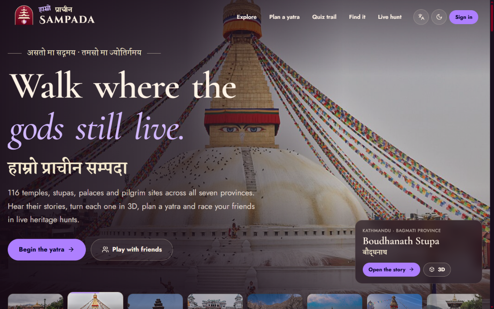

<div align="center">


<a href="https://hamrosampada-umber.vercel.app">
  
</a>

<br/>

[](https://hamrosampada-umber.vercel.app)


<br/>

**[Overview](#overview) · [Features](#features) · [Quick Start](#quick-start) · [Connect](#connect)**

</div>

---

## Overview

**Hamro Prachin Sampada (हाम्रो प्राचीन सम्पदा)** is an interactive Nepal cultural heritage explorer featuring **116 heritage sites**, a **3D model per site**, a **story map**, a **yatra planner**, **adaptive quizzes**, **Find the Monument**, **live multiplayer hunts**, and a **heritage passport**.

<p align="center">
  <a href="https://hamrosampada-umber.vercel.app">
    
  </a>
</p>

---

## Features

<table>
<tr>
<td width="50%" valign="top">

### Explore & 3D
- **116 heritage sites** with 3D monument models
- **Story map** with geographic and historical context
- **Yatra planner** for building cultural routes
- **Heritage passport** tracking visited & unlocked sites

</td>
<td width="50%" valign="top">

### Play & Compete
- **Live multiplayer hunts** powered by Socket.io
- **Adaptive quiz** engine (1,160+ curated questions)
- **Find the Monument** visual/clue challenge (696 clues)
- **12 unit tests + 18 API flow tests**

</td>
</tr>
</table>

---

<details>
<summary><b>Quick Start & Demo Accounts (click to expand)</b></summary>

### Requirements
- Node.js 20+
- MySQL 8.x (default port `3306`, user `root`)

### Setup
```bash
# 1) Import database (creates "sampada")
mysql -u root -p < database/sampada.sql

# 2) Start Server (http://localhost:5050)
cd server
npm install
npm run dev

# 3) Start Client (http://localhost:5174)
cd ../client
npm install
npm run dev
```

### Demo Accounts
| Role | Email | Password |
| :--- | :--- | :--- |
| Explorer | `demo@sampada.np` | `explorer123` |
| Admin | `admin@sampada.np` | `admin123` |

</details>

---

## Connect

<div align="center">

<a href="mailto:katwalniranjan7@gmail.com"></a>
<a href="https://github.com/itsniranjannn"></a>


</div>
